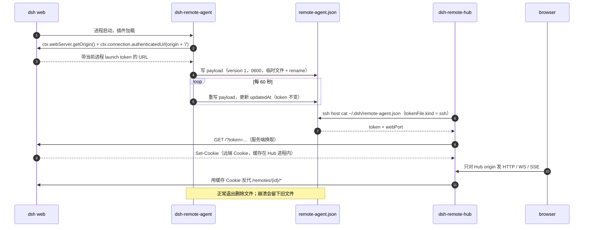

# dsh-remote-agent

<p align="center">
  <a href="https://github.com/yhuan416/dsh-remote-agent/releases"></a>
  <a href="https://github.com/yhuan416/dsh-remote-agent/blob/main/LICENSE"></a>
  =22.19.0" src="https://img.shields.io/badge/node-%3E%3D22.19.0-339933?logo=nodedotjs&logoColor=white">
  =0.2.1-rc.2" src="https://img.shields.io/badge/dsh-%3E%3D0.2.1--rc.2-4D6BFE">
  <a href="https://github.com/yhuan416/dsh-remote-agent/actions/workflows/check.yml"></a>
</p>

> [English](README.md) | 中文
>
> 架构：[ARCHITECTURE.md](ARCHITECTURE.md) ｜ 兼容性：[COMPATIBILITY.md](COMPATIBILITY.md)
> 变更记录：[CHANGELOG.md](CHANGELOG.md) ｜ 路线图：[TODO.md](TODO.md)
> 中文文档：[docs/ARCHITECTURE.zh.md](docs/ARCHITECTURE.zh.md) ｜ [docs/DEPLOY.zh.md](docs/DEPLOY.zh.md)
> 同族项目：[dsh-remote-hub](https://github.com/yhuan416/dsh-remote-hub) ｜ [dsh-opencode-client](https://github.com/yhuan416/dsh-opencode-client)

Agent 侧的 DSH 宿主插件，装在每个需要被 Hub 访问的后端上。**它只把当前进程的 launch token
与身份写进一个 0600 文件——不代理、不做隧道、不暴露 HTTP 路由、不加工具。**

它把当前 dsh 进程的 launch token 与身份写入 `$DSH_HOME/remote-agent.json`（0600，原子写），
每 60 秒刷新一次，进程正常退出时删除。token 由 dsh 按进程生成且不落盘，因此这个文件是 Hub
免手工贴 token、免翻日志取 token 的干净入口。

## 快速开始

```sh
# 1. 克隆
git clone https://github.com/yhuan416/dsh-remote-agent ~/.dsh/plugins/dsh-remote-agent

# 2. 装进 web profile（软链 + dependency + bundle 选择）
cd ~/.dsh/plugins/dsh-remote-agent && ./scripts/install.sh web

# 3. 重启 dsh web，然后验证：有 token，updatedAt 是新的
cat ~/.dsh/remote-agent.json
```

> **安装后必须重启 `dsh web`。** bundle 选择在启动时组合，装进一个已在运行的进程不会发布任何
> 文件，直到该进程重启。

## 目录

- [快速开始](#快速开始)
- [写入内容](#写入内容)
- [安装（bundle，推荐）](#安装bundle推荐)
- [安装（手工）](#安装手工)
- [与 Hub 配对](#与-hub-配对)
- [生态](#生态)
- [工作方式](#工作方式)
- [配置](#配置)
- [生命周期与安全](#生命周期与安全)
- [排错](#排错)
- [文档](#文档)
- [开发](#开发)

## 写入内容

```json
{
  "version": 1,
  "hostname": "yhuan-n100",
  "pid": 2533885,
  "startedAt": 1792413884370,
  "updatedAt": 1794197394348,
  "token": "<43 字符 launch token>",
  "webPort": 3080,
  "dshHome": "/home/yhuan/.dsh"
}
```

Hub 消费 `token`（用来换远端浏览器 Cookie）与 `webPort`（隧道该指向哪个远端端口）；
`hostname`/`pid`/`startedAt`/`updatedAt` 用于诊断与存活判断。`version: 1` 是文件 schema 版本，
增加字段向后兼容。

## 安装（bundle，推荐）

```sh
git clone https://github.com/yhuan416/dsh-remote-agent ~/.dsh/plugins/dsh-remote-agent
cd ~/.dsh/plugins/dsh-remote-agent
./scripts/install.sh web
```

脚本会软链包、把它登记为 profile **dependency**、选为 **bundle**（这样才会出现在
设置 → 插件里），并在存在旧的手工 patch 行时移除它。写文件前会备份；之后重启 `dsh web`
（bundle 选择在启动时组合）。

验证：

```sh
cat ~/.dsh/remote-agent.json    # 有 token，updatedAt 是新的
stat -c '%a %n' ~/.dsh/remote-agent.json   # 600
```

## 安装（手工）

```sh
mkdir -p ~/.dsh/plugins
tar xzf dsh-remote-agent.tgz -C ~/.dsh/plugins
ln -sfn ~/.dsh/plugins/dsh-remote-agent ~/.dsh/profiles/node_modules/dsh-remote-agent
ln -sfn ~/.dsh/plugins/dsh-remote-agent ~/.dsh/profiles/web/node_modules/dsh-remote-agent
```

在 `~/.dsh/profiles/web/cordis.patch.yml` 末尾加：

```yaml
- insert:
    - id: remote-agent
      name: dsh-remote-agent
```

重启 `dsh web`。手工 patch 行能让插件运行，但它不会作为已安装 bundle 出现在插件页——上面的
bundle 安装才是推荐方式。

## 与 Hub 配对

```yaml
# Hub 端：~/.dsh/profiles/web/cordis.patch.yml → dsh-remote-hub 配置
remotes:
  - id: n100
    label: yhuan@192.168.4.50
    ssh: { host: 192.168.4.50, user: yhuan }
    remotePort: 3080
    tokenFile:
      kind: ssh
      host: 192.168.4.50
      user: yhuan
      path: ~/.dsh/remote-agent.json
```

Hub 通过 ssh 读取 `token` 与 `webPort`。不装这个插件时，也可以在 Hub 配置里用内联
`token` 或本地可读的 `tokenFile`。

从 Hub 侧验证——探测结果应为 `tokenResolved: true`：

```sh
curl -s -X POST http://127.0.0.1:3080/api/remote-hosts/probe \
  -H 'content-type: application/json' -d '{"id":"n100"}'
```

## 生态

| 仓库 | 所在侧 | 职责 |
|---|---|---|
| [dsh-remote-hub](https://github.com/yhuan416/dsh-remote-hub) | Hub | 反向代理 + 托管 ssh 隧道 + token→Cookie 交换 + 顶栏切换 + 远端子代理 |
| **dsh-remote-agent**（本仓库） | 远端 | 发布当前进程的 launch token + 身份文件，供 Hub 读取 |
| [dsh-opencode-client](https://github.com/yhuan416/dsh-opencode-client) | 旁路 | 把 OpenCode 服务当作 dsh 子代理后端与客户端（与 dsh 远端这组独立） |

## 工作方式



浏览器只与 Hub 的 origin 通信（DSH 的同源限制要求如此）；远端 token 与远端 Cookie 都留在
服务端。本插件负责的就是前半段：让 Hub 能通过 ssh 读到 token。

## 配置

```yaml
- insert:
    - id: remote-agent
      name: dsh-remote-agent
      config:
        file: /custom/path/remote-agent.json   # 可选
```

profile 能解析 `@deepseek-ai/schemastery` 时会生成设置表单；解析不到时插件仍按默认值工作。

## 生命周期与安全

- 启动立即发布；拿不到 token 时最多重试约 10 秒（50 次 × 200 ms），之后 60 秒心跳继续尝试。
- 文件 0600；父目录不存在时按 0700 创建（不修改已有目录权限）。
- 原子写：临时文件（`remote-agent.json.tmp-<pid>`）加 rename，读者不会看到写了一半的 payload。
- 正常退出删除文件；崩溃会留下旧文件，Hub 探测失败后由下一次发布覆盖。
- token 是凭据：不要提交到仓库，也不要打进镜像。

## 排错

| 现象 | 检查 |
|---|---|
| 文件不存在 | 插件是否加载？设置 → 插件；安装后是否重启了 dsh web |
| 没有 `token` 字段 | DSH token 发现失败；核对 `dsh --version` 兼容性。盘上的文件可能是上一个进程留下的旧文件 |
| Hub 报 `tokenResolved: false` | ssh 路径/用户/host；`ssh <host> cat ~/.dsh/remote-agent.json` |
| `updatedAt` 很旧 | 远端 dsh 没运行，或心跳已停。文件每 60 秒重写，时间戳比几分钟还旧就说明进程已退出或卡住 |
| 文件权限不是 0600 | 插件按 0600 原子重写；用 `stat -c '%a %n' ~/.dsh/remote-agent.json` 确认。手工拷贝/写入的文件不在这个契约内 |
| 两个 profile 抢同一个文件 | 给每个实例配置不同的 `config.file`。两个进程共用一个 `DSH_HOME` 会争抢同一路径：后写者胜出，另一个 token 消失，Hub 侧会看到 `tokenResolved` 闪烁 |
| Hub 隧道指向错误端口 | `webPort` 是**监听**端口（`ctx.webServer.getOrigin()`）。若反向代理/NAT 对外端口不同，Hub 的 `remotePort` 必须是实际可达的端口；目前没有覆盖项（见 `TODO.md`） |

## 文档

- [ARCHITECTURE.md](ARCHITECTURE.md) — 角色、运行时序、payload、配置、刻意不实现；中文版见
  [docs/ARCHITECTURE.zh.md](docs/ARCHITECTURE.zh.md)。
- [docs/DEPLOY.zh.md](docs/DEPLOY.zh.md) — 中文部署与验证指南（bundle 安装、手工安装、验证、
  重启要求、profile 依赖 + bundle 写法、常见失败、安全红线）。
- [COMPATIBILITY.md](COMPATIBILITY.md) — 支持的 dsh/Node 版本与 DSH API 假设。
- [CHANGELOG.md](CHANGELOG.md) — 变更记录。
- [TODO.md](TODO.md) — 路线图与已知缺口。

## 开发

```sh
npm run check   # 离线：导出、manifest、bundle patch
```

CI 在每次 push 到 `main` 与 pull request 时运行同一命令（`.github/workflows/check.yml`，
Node 22），不需要 `npm install`。
